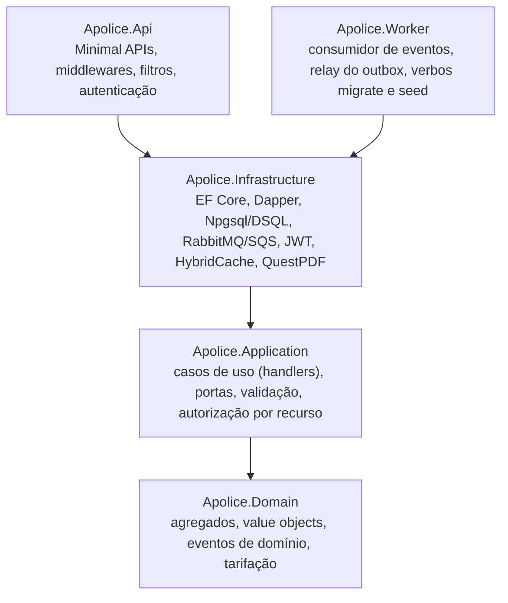
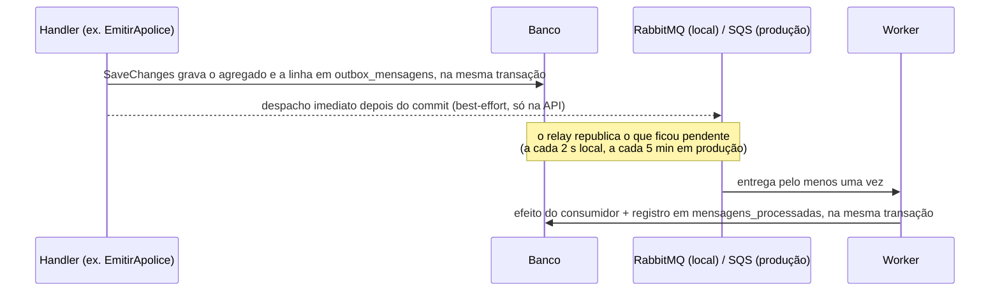
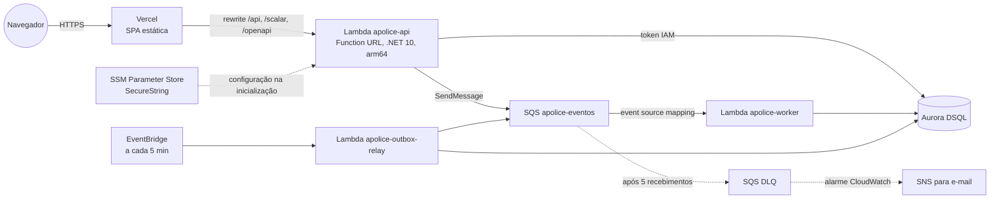

# Apólice

Plataforma de cotação, emissão e gestão de apólices de seguro (Auto, Residencial e Vida), com endosso, cancelamento e sinistro, feita em .NET 10 e React como projeto de portfólio.

[](https://github.com/LucasDEVBA/apolice/actions/workflows/ci.yml)
[](https://github.com/LucasDEVBA/apolice/actions/workflows/codeql.yml)
[](LICENSE)


## Demo ao vivo

| O quê | Endereço |
|---|---|
| Aplicação | [apolice.vercel.app](https://apolice.vercel.app) |
| Documentação da API (Scalar, OpenAPI 3.1) | [apolice.vercel.app/scalar/v1](https://apolice.vercel.app/scalar/v1) |

Na tela de login, os botões de persona entram sem senha como um dos quatro usuários de demonstração:

| Persona | Usuário | Papel |
|---|---|---|
| Corretora | Ana Ribeiro | Corretor |
| Corretor | Bruno Lima | Corretor |
| Analista | Carla Souza | Analista de sinistros |
| Admin | Diego Martins | Administrador |

Todos os dados são fictícios: produtos, taxas e segurados existem só para a demonstração, e os e-mails são simulados (aparecem numa caixa de saída dentro da própria aplicação). A API roda em AWS Lambda, então a primeira requisição depois de um tempo parado pode levar alguns segundos a mais (cold start).

## O que o sistema faz

O ciclo de vida de uma apólice, do jeito que cada papel o enxerga:

```
cotação ──► aceite ──► emissão ──► endosso / cancelamento
                          │
                          └──► sinistro ──► análise ──► aprovação ou negativa ──► pagamento
```

**Corretor** (Ana, Bruno) trabalha só na própria carteira:
- **Cota** Auto, Residencial ou Vida. A tarifação é recalculada ao vivo enquanto o formulário é preenchido (uma simulação que não grava nada) e mostra a memória de cálculo: prêmio de cada cobertura, fatores aplicados (idade do condutor, região pelo CEP, uso comercial, idade do veículo e bônus no Auto; tipo de imóvel e veraneio no Residencial; faixa etária e fumante no Vida), IOF e número máximo de parcelas. A cotação gravada vale 30 dias.
- **Aceita ou recusa** a cotação e **emite** a apólice: vigência de um ano com início em até 30 dias, número no formato `AUTO-2026-000042` e parcelamento em até 10 vezes (o máximo é o prêmio total dividido por R$ 60,00, entre 1 e 10).
- **Endossa** a apólice ativa (altera o LMI, inclui ou exclui cobertura). O sistema simula antes e cobra ou devolve a diferença *pro rata* pelos dias restantes.
- **Cancela** com simulação da restituição: integral antes do início da vigência; tabela de prazo curto quando o segurado pede; *pro rata die* nos demais motivos.
- **Abre sinistro** dentro da vigência, numa cobertura que aceita sinistro (assistência 24h e carro reserva não aceitam) e que existia na data da ocorrência: um endosso posterior não conta.
- Baixa o **PDF da apólice**.

**Analista** (Carla) enxerga a carteira inteira, mas não opera cotações nem apólices. Conduz o sinistro: inicia a análise, aprova com valor até o menor entre o reclamado e o LMI, nega com motivo ou registra o pagamento. Cada sinistro novo recebe uma **triagem automática** com score de 0 a 100 e alertas (vigência recente, valor perto ou acima do LMI, comunicação tardia).

**Administrador** (Diego) faz tudo o que os outros fazem, altera taxas de cobertura do catálogo e consulta a trilha de **auditoria**.

Nos bastidores, cada fato relevante (apólice emitida, endossada ou cancelada, sinistro aberto, aprovado, negado ou pago) vira um evento processado de forma assíncrona: e-mail de boas-vindas e demais notificações, e a triagem do sinistro. O dashboard mostra prêmio emitido, conversão de cotações, sinistralidade e carteira por produto, no escopo do usuário (carteira própria ou global).

## Arquitetura

Clean Architecture em quatro camadas. A seta indica "depende de"; o domínio não depende de nada além da biblioteca padrão do .NET.



Um evento de domínio sai da transação do caso de uso até o consumidor assim:



Em produção, tudo é serverless e cobrado por uso:



As três funções leem a configuração do mesmo prefixo do SSM. O navegador só fala com a Vercel, que reescreve `/api/*` para a Function URL: a API fica na mesma origem do frontend, o cookie de refresh é first-party e não existe CORS a configurar ([ADR 0006](docs/adr/0006-serverless-lambda-function-url-rewrite-vercel.md)).

## Destaques técnicos

Cada item aponta para onde está no código. A especificação completa fica em [`docs/SPEC.md`](docs/SPEC.md).

- **DI, options e composição.** `AddApplication()` registra os handlers por varredura do assembly com `TryAdd*` (chamar duas vezes não duplica nada) e `AddInfrastructure()` compõe todas as portas. As options críticas são validadas na subida (`ValidateOnStart` + `IValidateOptions<T>`): configuração errada derruba o host no deploy, não na primeira requisição. Ver [`Application/DependencyInjection.cs`](src/Apolice.Application/DependencyInjection.cs) e [`Infrastructure/DependencyInjection.cs`](src/Apolice.Infrastructure/DependencyInjection.cs).
- **Pipeline HTTP e Minimal APIs.** Endpoints agrupados por contexto e versionados em `/api/v1`, OpenAPI 3.1 nativo com Scalar, erros em ProblemDetails (RFC 9457) e uma ordem de middlewares explícita: forwarded headers, tratamento de exceção, HSTS, correlation id, headers de segurança, log de requisição, CORS, autenticação, rate limiting, autorização. A autenticação vem antes do limitador para o limite por usuário usar o JWT já validado. Validação (FluentValidation), `Idempotency-Key` e o header anti-CSRF entram como filtros de endpoint. Ver [`PipelineExtensions.cs`](src/Apolice.Api/Extensions/PipelineExtensions.cs) e [`src/Apolice.Api/Http`](src/Apolice.Api/Http).
- **Clean Architecture sem mediator.** Handlers explícitos (`ICommandHandler<TCommand, TResponse>`) injetados direto nos endpoints, sem MediatR. São 40 handlers (32 casos de uso e 8 consumidores de evento), e um teste conta quantos são e confere que todos resolvem pela DI ([ADR 0001](docs/adr/0001-clean-architecture-handlers-explicitos.md)).
- **DDD tático.** Agregados (`Cotacao`, `ApoliceSeguro`, `Sinistro`, `Produto`, `Usuario`, `RefreshToken`), value objects (`Dinheiro`, `Cpf`, `Email`, `Vigencia`, `Segurado`), eventos de domínio e `Result<T>` para falhas previsíveis; exceção fica para bug e falha de infraestrutura. Ver [`src/Apolice.Domain`](src/Apolice.Domain).
- **Strategy na tarifação.** Uma estratégia por produto (`TarifacaoAuto`, `TarifacaoResidencial`, `TarifacaoVida`) sobre uma base com as validações comuns (Template Method). O `Tarifador` escolhe pelo código do produto. Tempo sempre injetado e dinheiro em `decimal` com arredondamento `AwayFromZero` ([ADR 0007](docs/adr/0007-tarifacao-strategy-tempo-injetado-decimal.md)).
- **CQRS-lite.** EF Core 10 com change tracking na escrita e Dapper com SQL parametrizado nas listagens e no dashboard, com paginação keyset por cursor opaco. Os dois usam o mesmo `NpgsqlDataSource` ([ADR 0002](docs/adr/0002-cqrs-lite-ef-core-escrita-dapper-leitura.md)).
- **Concorrência otimista.** Cada agregado tem `Versao`; um interceptor a incrementa quando a raiz *ou qualquer filho* muda, e o conflito vira 409. No Aurora DSQL, os conflitos de OCC (`40001`, `OC000`, `OC001`) entram na estratégia de retry do EF ([`VersaoInterceptor.cs`](src/Apolice.Infrastructure/Persistence/Interceptors/VersaoInterceptor.cs)).
- **Outbox transacional e consumidores idempotentes.** Eventos viram linhas do outbox no mesmo `SaveChanges` do agregado. A API publica logo após o commit e um relay cobre as falhas. O consumidor registra `(mensagem, consumidor)` na mesma transação do efeito, então a reentrega não duplica e-mail nem triagem. RabbitMQ com fila quorum e DLQ no ambiente local, SQS com DLQ e falha parcial de lote em produção ([ADR 0004](docs/adr/0004-outbox-transacional-rabbitmq-sqs.md)).
- **Segurança (OWASP).** Access token JWT de 15 min só em memória no frontend; refresh token rotativo de 7 dias em cookie `HttpOnly; Secure; SameSite=Strict` restrito a `/api/v1/auth`, guardado no banco só como SHA-256. Reuso de um token já rotacionado revoga a família inteira. Bloqueio após 5 senhas erradas, mesma resposta para e-mail inexistente e senha errada, autorização por recurso que responde **404** para recurso de outra carteira (anti-BOLA/IDOR), rate limiting, headers de segurança, auditoria e CPF mascarado nas listagens e nos logs ([ADR 0005](docs/adr/0005-jwt-refresh-rotativo-cookie-anti-bola.md)).
- **Observabilidade.** Logs estruturados (Serilog, JSON em produção) com correlation id, que também vai para o outbox e a auditoria. OpenTelemetry com traces e métricas de negócio (`apolices_emitidas`, `premio_emitido`, `sinistros_abertos`), e o `traceparent` viaja dentro da mensagem: o trace da requisição continua no Worker. Health checks `/health/live` e `/health/ready` (banco e broker). Localmente, o Aspire Dashboard mostra os traces e as métricas.
- **Cache, feature flags e rate limiting.** Catálogo de produtos em `HybridCache` com invalidação por tag quando o admin muda uma taxa; quatro flags (`LoginDemo`, `TriagemAutomaticaSinistros`, `DocumentoPdf`, `EndossoOnline`) sobre `Microsoft.FeatureManagement`; limite de 10 requisições por minuto por IP nos endpoints de autenticação e limite global por usuário ([ADR 0008](docs/adr/0008-feature-flags-hybridcache-rate-limiting.md)).
- **Testes por nível.** Contagem de 22/10/2026:

  | Nível | Testes | Como |
  |---|---|---|
  | Domain | 548 | Puros, sem mock; valores de tarifação calculados à mão em cada caso |
  | Application | 398 | Handlers com banco em memória que só "commita" no `SaveChanges`, `FakeTimeProvider` e fakes das portas |
  | Integração | 157 | PostgreSQL e RabbitMQ em Testcontainers, com migrations reais: 93 testes da infraestrutura com a composição de DI real e 64 da API inteira (`WebApplicationFactory<Program>`) e dos handlers do Worker |
  | E2E | Playwright | Stack inteira no `docker compose`, rodando no CI |

  O CI falha se a cobertura de linhas de Domain + Application ficar em 80% ou menos.
- **CI/CD com OIDC.** GitHub Actions com actions fixadas por SHA. O build regenera `docs/openapi/v1.json` e falha se o contrato commitado estiver velho; o job do frontend regenera os tipos TypeScript a partir dele e falha se houver drift. O deploy só publica a ponta da `main` com CI verde, compila num job sem acesso ao token OIDC e assume a role da AWS por OIDC, sem chave de acesso guardada. Depois do `terraform apply`, roda migrations, seed e smoke test ([`.github/workflows`](.github/workflows)).
- **Terraform.** Lambdas .NET 10 arm64, Function URL, SQS com DLQ e alarme, regra do EventBridge, Aurora DSQL com proteção contra exclusão, segredos em SSM gravados como *write-only* (não aparecem no state nem no plan), orçamento mensal e uma role de deploy que não consegue escalar privilégio: ela não altera a si mesma e as roles das funções ficam sob um permission boundary ([`infra/terraform/README.md`](infra/terraform/README.md)).
- **Frontend.** Vite, React 19, TypeScript strict, TanStack Query, React Router, React Hook Form com Zod, Tailwind CSS 4, Radix e Recharts. O cliente HTTP é tipado a partir do OpenAPI. A meta de acessibilidade é WCAG 2.1 AA, mobile first, com tema claro e escuro ([`docs/design/DESIGN.md`](docs/design/DESIGN.md)).

## Como rodar localmente

**Pré-requisitos**
- Docker com Compose v2
- SDK do .NET 10 (o `global.json` fixa 10.0.402 e aceita feature bands mais novas)
- Node.js 24 ou mais novo, com pnpm 10 (`corepack enable` instala a versão do `packageManager`)

**Stack inteira em containers** (PostgreSQL, RabbitMQ, migrations, seed, API e Worker):

```bash
git clone https://github.com/LucasDEVBA/apolice.git
cd apolice
docker compose up -d --build --wait
```

| Serviço | Endereço |
|---|---|
| API | http://localhost:8080 (Scalar em `/scalar/v1`, prontidão em `/health/ready`) |
| RabbitMQ (painel) | http://localhost:15672 (usuário `apolice`, senha `apolice-dev`) |

As senhas do compose são de brinquedo de propósito e as portas só abrem no loopback. Para ver traces e métricas, suba o Aspire Dashboard; para testar o L2 do cache, o Valkey:

```bash
OTEL_EXPORTER_OTLP_ENDPOINT=http://aspire-dashboard:18889 docker compose --profile observability up -d   # http://localhost:18888
Redis__ConnectionString=valkey:6379,abortConnect=false docker compose --profile cache up -d
```

**Frontend** (servidor de desenvolvimento com proxy de `/api` para a porta 8080, a mesma origem que a Vercel dá em produção):

```bash
cd frontend
corepack enable
pnpm install
pnpm dev        # http://localhost:5173
```

**API e Worker fora do container**, para depurar com breakpoints. Suba só o banco e o broker, aplique as migrations e o seed e rode a API. O perfil de `dotnet run` da API usa a porta 5080; o `--urls` abaixo a põe na 8080, que é para onde o proxy do Vite aponta:

```bash
docker compose up -d --wait postgres rabbitmq

export ConnectionStrings__Apolice="Host=127.0.0.1;Port=5432;Database=apolice;Username=apolice;Password=apolice-dev"
export Messaging__RabbitMq__Host=127.0.0.1 Messaging__RabbitMq__Username=apolice Messaging__RabbitMq__Password=apolice-dev

dotnet run --project src/Apolice.Worker -- migrate
dotnet run --project src/Apolice.Worker -- seed
Outbox__DispatchImediato=true dotnet run --project src/Apolice.Api --urls http://127.0.0.1:8080
dotnet run --project src/Apolice.Worker   # em outro terminal: relay do outbox + consumidor RabbitMQ
```

Em Development, a API gera uma chave JWT efêmera se `Jwt__SigningKey` não estiver definida, e o seed gera uma senha aleatória para os usuários demo se `Seed__SenhaUsuarios` não estiver definida; o login por persona dispensa a senha. Fora de Development, as duas são obrigatórias.

## Testes

```bash
dotnet test Apolice.slnx            # todos os níveis do backend (integração precisa do Docker rodando)
dotnet test tests/Apolice.Domain.Tests
dotnet test tests/Apolice.Application.Tests

cd frontend
pnpm test                           # Vitest + Testing Library + axe
pnpm test:e2e                       # Playwright; precisa da stack do compose de pé (o preview do front sobe sozinho)
```

No GitHub Actions, o CI roda tudo isso e ainda lint, typecheck, cobertura mínima, contrato OpenAPI sem drift e `terraform fmt`/`validate`; um workflow separado roda o CodeQL.

## Estrutura de pastas

```
src/
  Apolice.Domain/           agregados, value objects, eventos, tarifação (só BCL)
  Apolice.Application/      casos de uso, portas (interfaces), validação, autorização por recurso
  Apolice.Infrastructure/   EF Core + migrations, Dapper, DSQL, outbox, RabbitMQ/SQS, JWT, cache, PDF, seed
  Apolice.Api/              Minimal APIs, middlewares, filtros (host HTTP e Lambda)
  Apolice.Worker/           consumidor, relay do outbox, migrate/seed (host local e handlers Lambda)
tests/
  Apolice.Domain.Tests/  Apolice.Application.Tests/  Apolice.Api.IntegrationTests/  Apolice.ArchitectureTests/
frontend/                   Vite + React 19 + TypeScript
infra/
  bootstrap/                bucket S3 do state do Terraform
  terraform/                Lambdas, SQS, DSQL, SSM, OIDC, alarmes, orçamento
docs/
  SPEC.md                   especificação técnica (fonte da verdade)
  adr/                      registros de decisão
  design/                   guia de design do frontend
  openapi/v1.json           contrato gerado no build
  ESTUDO.md                 guia de estudo do código
```

## Decisões de arquitetura

| ADR | Decisão |
|---|---|
| [0001](docs/adr/0001-clean-architecture-handlers-explicitos.md) | Clean Architecture com handlers explícitos, sem MediatR |
| [0002](docs/adr/0002-cqrs-lite-ef-core-escrita-dapper-leitura.md) | CQRS-lite: EF Core na escrita, Dapper na leitura |
| [0003](docs/adr/0003-aurora-dsql-producao-postgresql-local.md) | Aurora DSQL em produção, PostgreSQL local e no CI, migrator próprio |
| [0004](docs/adr/0004-outbox-transacional-rabbitmq-sqs.md) | Outbox transacional, RabbitMQ local, SQS em produção, consumidores idempotentes |
| [0005](docs/adr/0005-jwt-refresh-rotativo-cookie-anti-bola.md) | JWT curto, refresh rotativo em cookie HttpOnly, anti-BOLA com 404 |
| [0006](docs/adr/0006-serverless-lambda-function-url-rewrite-vercel.md) | Lambda com Function URL atrás do rewrite da Vercel (mesma origem) |
| [0007](docs/adr/0007-tarifacao-strategy-tempo-injetado-decimal.md) | Tarifação por Strategy, tempo injetado, dinheiro em `decimal` com `AwayFromZero` |
| [0008](docs/adr/0008-feature-flags-hybridcache-rate-limiting.md) | Feature flags, HybridCache e rate limiting |

## Custos em produção

O custo esperado com o tráfego de um portfólio fica perto de **US$ 0 por mês**. Não existe nada ligado cobrando por hora: todo recurso é cobrado por uso, e o uso de uma demo cabe nas franquias gratuitas mensais da AWS que não expiram.

| Recurso | Por que sai de graça nesse volume |
|---|---|
| Lambda (API 1024 MB, Worker e relay 512 MB, arm64) | A franquia mensal é de 1 milhão de requisições e 400 mil GB-s. O relay roda a cada 5 min, cerca de 8.640 invocações por mês |
| Aurora DSQL | Serverless, sem instância ociosa. Os primeiros 100 mil DPUs e 1 GB de armazenamento de cada mês são gratuitos |
| SQS (fila + DLQ) | 1 milhão de requisições por mês na franquia. O polling da Lambda conta requisições mesmo com a fila vazia, então é o item a acompanhar no primeiro mês |
| SSM Parameter Store | Parâmetros padrão não são cobrados; a chave KMS é a gerenciada `aws/ssm`, sem mensalidade |
| CloudWatch, EventBridge, SNS | Logs com retenção de 14 dias, um alarme, uma regra agendada e e-mail de alerta, tudo dentro das franquias |
| S3 (state do Terraform) | Alguns KB e poucas requisições por deploy: frações de centavo |
| Vercel | Site estático com rewrites, dentro do plano gratuito (Hobby) |

O Terraform cria um orçamento de US$ 5 por mês que avisa por e-mail em 80% do gasto real e em 100% do previsto. O risco conhecido é a Function URL ser pública: chamadas diretas pulam a Vercel e o rate limiting da aplicação só age depois da invocação, que já foi cobrada. O [README da infraestrutura](infra/terraform/README.md#limitações-conhecidas) estima o pior caso e descreve o freio (`api_reserved_concurrency`).

## Próximos passos

Limitações conhecidas e o que faria a seguir, sem enfeite:

- **Regras de arquitetura no ArchUnitNET.** O projeto `Apolice.ArchitectureTests` existe, mas ainda não tem regras. Hoje a regra de dependência da Application é garantida por um teste de reflexão em `Apolice.Application.Tests` (`Deve_referenciar_so_dominio_e_abstracoes_quando_compila_a_aplicacao`).
- **Teto de concorrência da API.** Sem `api_reserved_concurrency`, um flood na Function URL pública pode ocupar a concorrência da conta. Contas novas têm limite de 10 execuções simultâneas, o que impede reservar; o freio entra quando a cota permitir.
- **Rate limiting por instância e IP forjável.** O limitador do ASP.NET Core guarda estado em memória, então cada container Lambda conta sozinho. E, como os IPs da Vercel não são fixos, a API aceita `X-Forwarded-For` de qualquer remetente: quem chama a Function URL direto pode forjar o header e trocar de partição no limite por IP (o limite por usuário autenticado não depende disso). Os dois pedem a mesma correção: aceitar só tráfego do proxy e contar na borda (CloudFront/WAF) ou em estado compartilhado.
- **Cache por instância.** Sem L2 em produção, cada container tem o próprio catálogo em cache: depois de uma mudança de taxa, outro container pode simular com a taxa anterior por até 10 minutos. A cotação gravada sempre lê o cadastro, nunca o cache.
- **Cold start.** SnapStart está desligado (em .NET ele cobra cache e restore), então a primeira requisição de um container novo é mais lenta.
- **Simplificações de negócio documentadas.** IOF não é restituído no cancelamento, produtos e taxas são fictícios, e-mails são simulados, e o cronograma de parcelas não é redistribuído depois de um endosso (o ajuste é cobrado ou devolvido à parte).
- **Limpeza do outbox.** Mensagens publicadas são marcadas, não apagadas; falta uma rotina que remova as antigas.
- **Banco em uma região.** O cluster DSQL é single-region; multi-região mudaria o modelo de custo e de latência.
- **Rollback.** As migrations só avançam: voltar versão em produção é `revert` na `main`, não redeploy de commit antigo.

## Licença

[MIT](LICENSE) © 2026 Lucas Almeida Costa
