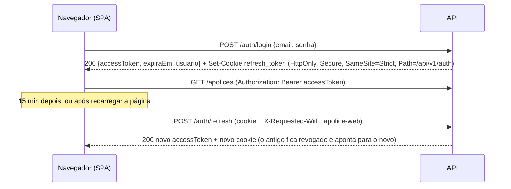

# Guia de estudo do Apólice

Este guia é para quem precisa **explicar e defender** este código numa entrevista técnica de C#/.NET: o que cada parte faz, por que foi feita assim e onde está. A ordem importa: cada seção usa o que a anterior explicou.

Como estudar:

1. Leia uma seção e abra os arquivos citados ao lado. Os caminhos partem da raiz do repositório; dentro da seção de uma camada e nas respostas da última seção, aparecem abreviados a partir do projeto (`Persistence/ApoliceDbContext.cs` é `src/Apolice.Infrastructure/Persistence/ApoliceDbContext.cs`).
2. Rode os testes do trecho que está estudando, por exemplo `dotnet test tests/Apolice.Domain.Tests --filter "FullyQualifiedName~TarifacaoAutoTests"`.
3. No fim, responda às perguntas da última seção em voz alta, sem olhar, e depois confira.

`Apolice.Api` e `Apolice.Worker` implementam a SPEC §7 e §8, com dois ajustes conscientes que valem ouro numa entrevista (a ordem autenticação → rate limiting e a aceitação do `X-Forwarded-For`), explicados na seção do pipeline. Os trechos citados refletem o código de 22/10/2026.

## Mapa rápido

| Se perguntarem sobre... | Abra |
|---|---|
| Regras de dependência entre camadas | `docs/SPEC.md` §3, `tests/Apolice.Application.Tests/Composicao/DependencyInjectionTests.cs` |
| `Result`, erros previsíveis | `src/Apolice.Domain/Comum/Result.cs`, `Error.cs`, `ErrorType.cs` |
| Agregado, evento de domínio, versão | `src/Apolice.Domain/Comum/AggregateRoot.cs`, `DomainEvent.cs` |
| Strategy | `src/Apolice.Domain/Tarifacao/Tarifador.cs`, `TarifacaoBase.cs`, `TarifacaoAuto.cs` |
| Um caso de uso de ponta a ponta | `src/Apolice.Application/Features/Apolices/Emitir/EmitirApoliceHandler.cs` |
| Anti-BOLA | `src/Apolice.Application/Common/AcessoUsuario.cs` |
| Login, refresh, reuso de token | `src/Apolice.Application/Features/Auth/Login/LoginHandler.cs`, `Refresh/RefreshHandler.cs` |
| DI e lifetimes | `src/Apolice.Application/DependencyInjection.cs`, `src/Apolice.Infrastructure/DependencyInjection.cs` |
| EF Core, concorrência, interceptors | `src/Apolice.Infrastructure/Persistence/ApoliceDbContext.cs`, `Persistence/Interceptors/` |
| Dapper e keyset | `src/Apolice.Infrastructure/Persistence/Queries/Sql.cs`, `ApoliceQueries.cs`, `src/Apolice.Application/Common/Cursor.cs` |
| Outbox e inbox | `src/Apolice.Infrastructure/Persistence/Interceptors/DomainEventsToOutboxInterceptor.cs`, `src/Apolice.Infrastructure/Outbox/OutboxDispatcher.cs`, `src/Apolice.Application/Features/Eventos/IntegrationEventDispatcher.cs` |
| RabbitMQ e SQS | `src/Apolice.Infrastructure/Messaging/` |
| Aurora DSQL | `src/Apolice.Infrastructure/Persistence/Provedores/FonteDadosNpgsql.cs`, `src/Apolice.Infrastructure/Persistence/Migracao/` |
| Testes | `tests/*/Suporte/` e `tests/Apolice.Api.IntegrationTests/*/Suporte/` |
| Deploy | `.github/workflows/deploy.yml`, `infra/terraform/` |

## Tour pelo código

### 1. O contrato

Comece por `docs/SPEC.md`. Leia com atenção a §2 (convenções: dinheiro, datas, nomes de teste), a §3 (camadas e o que cada uma pode referenciar), a §4 (regras de negócio), a §5 (regras dos handlers) e a §7 (pipeline HTTP e endpoints). O resto do código implementa esse texto, e muitos comentários citam a seção ("SPEC 4.4").

### 2. Domínio: o kernel comum

Em `src/Apolice.Domain/Comum/`:

- **`Result.cs` e `Error.cs`.** Falha previsível (validação, regra de negócio, não encontrado) é valor de retorno, não exceção. `Result<T>` tem conversão implícita de `T` e de `Error`, então um método pode fazer `return TarifacaoErros.CepInvalido;` ou `return apolice;`. Ler `.Value` de uma falha lança: é bug de quem chamou. `ErrorType` (Validacao, NaoEncontrado, Conflito, Proibido, RegraDeNegocio, NaoAutorizado) é o que a API traduz para status HTTP.
- **`Entity.cs` e `AggregateRoot.cs`.** Igualdade por id. O agregado guarda uma lista privada de eventos (`Raise`) e expõe `Versao`, que só a infraestrutura incrementa.
- **`DomainEvent.cs`.** Base dos eventos: o `OcorridoEm` vem sempre do chamador e o `EventoId` é um UUID v7 ancorado nesse instante. Esse id vira a chave de idempotência do outbox e do inbox.
- **Value objects.** `Dinheiro` (arredondamento e formatação pt-BR sem ICU), `Cpf` (dígitos verificadores, máscara), `Email`, `Vigencia` (dias totais, decorridos, restantes), `Segurado`.
- **`Relogio.cs`.** "Hoje" no fuso de Brasília com offset fixo −03:00, a partir de um `TimeProvider` ou de um instante recebido.

### 3. Domínio: tarifação (Strategy)

Em `src/Apolice.Domain/Tarifacao/`, leia nesta ordem: `ITarifador.cs`, `IEstrategiaTarifacao.cs`, `Tarifador.cs`, `TarifacaoBase.cs`, `TarifacaoAuto.cs`. Depois abra `tests/Apolice.Domain.Tests/Tarifacao/TarifacaoAutoTests.cs` e confira uma conta à mão.

O `Tarifador` é só um dicionário de estratégias por código de produto:

```csharp
public Tarifador(IEnumerable<IEstrategiaTarifacao> estrategias)
{
    // ToDictionary lança com código repetido: duas estratégias para o mesmo produto é erro de composição.
    _estrategias = estrategias.ToDictionary(e => e.ProdutoCodigo, StringComparer.Ordinal);
}
```

`TarifacaoBase<TDados>` é um **Template Method**: o método `Calcular` é fixo (valida a entrada, seleciona coberturas, resolve LMIs, aplica fatores, monta o resultado) e cada produto só implementa os ganchos `ValidarDados`, `DefinirFatores`, `LmiDefinidoPeloRisco` e `ValidarLmis`. Repare no encadeamento sem `if` aninhado:

```csharp
var validacao = ValidarEntrada(dados, segurado, dataReferencia);
var selecao = validacao.IsSuccess ? SelecionarCoberturas(produto, coberturas) : validacao.Error;
var comLmi = selecao.IsSuccess ? ResolverLmis(selecao.Value, dados) : selecao.Error;
```

### 4. Domínio: o ciclo de vida

- **`Cotacoes/Cotacao.cs`.** Máquina de estados `Calculada → Aceita → Emitida` (ou `Recusada`), validade de 30 dias e status efetivo "Expirada", calculado e nunca gravado.
- **`Apolices/ApoliceSeguro.cs`.** `Emitir` é uma fábrica estática que valida a cotação, a data de início e as parcelas, marca a cotação como emitida e levanta `ApoliceEmitida`. Veja `CronogramaParcelas` (base truncada, a primeira parcela absorve a sobra) e `CoberturaEm(codigo, data)`, que reconstrói a cobertura vigente numa data passada desfazendo endossos posteriores.
- **`ApoliceSeguro.Endossos.cs`.** O endosso recebe o `ITarifador` **por parâmetro** (o domínio usa o serviço sem depender de DI), retarifa o conjunto inteiro com a data de emissão e calcula o ajuste *pro rata* pelos dias restantes.
- **`ApoliceSeguro.Cancelamento.cs` e `CalculadoraCancelamento.cs`.** A regra de restituição é uma função pura (integral, prazo curto ou pro rata die), testável sem montar apólice; `TabelaPrazoCurto.cs` tem a tabela.
- **`Sinistros/Sinistro.cs` e `AvaliadorTriagem.cs`.** Abertura com validação da ocorrência e da cobertura na data, transições com histórico e evento, e a triagem com score.
- **`Usuarios/Usuario.cs` e `RefreshToken.cs`.** Bloqueio na 5ª falha por 15 minutos; refresh guardado como hash, com família e rotação.

### 5. Aplicação: contratos e um caso de uso completo

Em `src/Apolice.Application/Abstractions/`: `Messaging/ICommandHandler.cs` (o contrato dos casos de uso), `Data/IUnitOfWork.cs` e os repositórios, `Queries/` (portas de leitura), `Security/ICurrentUser.cs`.

Agora leia `Features/Apolices/Emitir/EmitirApoliceHandler.cs` linha a linha. É o melhor exemplo do roteiro que todo handler de mutação segue:

1. `usuario.ExigirAutenticado()` **antes** de carregar qualquer coisa. Senão um anônimo receberia 404 para id inexistente e 401 para id existente, e descobriria quais ids existem.
2. Carrega a cotação pelo repositório (com tracking).
3. `usuario.AutorizarCarteira(cotacao.CorretorId, ...)`: 404 se for de outro corretor, 403 se for analista.
4. Abre um span de trace (`ApoliceTelemetry.ActivitySource.StartActivity`).
5. `cotacao.ValidarEmissao(agora)` **antes** de numerar: a recusa mais comum (duplo clique numa cotação já emitida) não gasta número.
6. `numerador.ProximoAsync(...)` numa conexão própria, fora da transação.
7. `ApoliceSeguro.Emitir(...)`: a regra está no domínio.
8. `apolices.Adicionar`, `auditoria.Registrar`, `unitOfWork.SaveChangesAsync`: uma transação grava a apólice, as coberturas, a cotação alterada (com a versão conferida), a linha do outbox e a auditoria.
9. Métricas de negócio **depois** do commit, para não contar uma emissão que não foi gravada.
10. Log com `[LoggerMessage]`: o método é gerado em tempo de compilação, sem interpretar o template nem montar um array de argumentos a cada chamada.
11. Relê pela porta de consulta para devolver o DTO completo.

Depois leia `Features/Apolices/AcessoApolice.cs`: os passos 1 a 3 extraídos para endosso, cancelamento e abertura de sinistro.

### 6. Aplicação: autenticação, eventos e composição

- `Features/Auth/Login/LoginHandler.cs`, `Refresh/RefreshHandler.cs`, `EmissorSessao.cs`, `RevogacaoSessao.cs` (ver a seção [JWT, refresh e BOLA](#jwt-refresh-e-bola)).
- `Features/Eventos/IntegrationEventDispatcher.cs` e um consumidor, `BoasVindasApoliceEmitidaHandler.cs` (ver [Outbox, inbox e at-least-once](#outbox-inbox-e-at-least-once)).
- `Features/Cotacoes/TarifacaoCotacao.cs`: a simulação lê o catálogo em cache; a criação lê o cadastro.
- `DependencyInjection.cs`: varredura de handlers (ver [Injeção de dependência e lifetimes](#injeção-de-dependência-e-lifetimes)).

### 7. Infraestrutura

Em `src/Apolice.Infrastructure/`, nesta ordem:

1. `DependencyInjection.cs`: tudo o que é registrado e com que lifetime.
2. `Persistence/ApoliceDbContext.cs`, `Persistence/Configurations/ApoliceConfiguration.cs`, `ComplexosComuns.cs`: o mapeamento.
3. `Persistence/Interceptors/`: `DomainEventsToOutboxInterceptor`, `VersaoInterceptor`, `OrdemFilhosInterceptor`, `OutboxDispatchImediatoInterceptor`.
4. `Persistence/Repositories/Carregamentos.cs` e `Repositorios.cs`: como um agregado é carregado.
5. `Persistence/Queries/Sql.cs` e `ApoliceQueries.cs`: o lado de leitura.
6. `Persistence/Numerador.cs`: upsert atômico com retry.
7. `Outbox/OutboxDispatcher.cs` e `Messaging/` (processador, RabbitMQ, SQS).
8. `Persistence/Provedores/FonteDadosNpgsql.cs` e `ErrosTransitorios.cs`, `Persistence/Migracao/`: o DSQL.
9. `Security/` (JWT, PBKDF2), `Services/CatalogoProdutosCache.cs`, `Idempotencia/ArmazemIdempotencia.cs`, `Persistence/Seed/DataSeeder.cs`.

### 8. API e Worker

Em `src/Apolice.Api/`:

1. `Program.cs`: só a composição, em métodos de extensão com nome (`AddConfiguracaoApolice`, `AddLogsApolice`, `AddSegurancaApi`, `AddHttpApi`, `AddDocumentacaoApi`, `AddObservabilidadeApi`, `UsePipelineApolice`, `MapEndpointsApolice`).
2. `Extensions/PipelineExtensions.cs`: a ordem dos middlewares. `Extensions/SegurancaExtensions.cs`: JWT, políticas, CORS, forwarded headers. `Extensions/ConfiguracaoExtensions.cs`: hosting da Lambda e SSM.
3. `Endpoints/*Endpoints.cs`: um arquivo por contexto, cada um com um `MapXxxEndpoints`; `Extensions/EndpointsExtensions.cs` monta o grupo `/api/v{version:apiVersion}` e os health checks.
4. `Http/`: `ResultadosHttp.cs` e `Problemas.cs` (de `Result` para HTTP), `ApoliceExceptionHandler.cs`, `CorrelationIdMiddleware.cs`, `SecurityHeadersMiddleware.cs`, `ValidationFilter.cs`, `IdempotencyFilter.cs`, `CabecalhoCsrfFilter.cs`, `CookieRefresh.cs`, `LimitesRequisicao.cs`.
5. `Seguranca/HttpCurrentUser.cs`: o `ICurrentUser` a partir dos claims do JWT.

Em `src/Apolice.Worker/`:

1. `Program.cs`: um binário, três papéis. Os verbos `migrate` e `seed`, o host local sem argumentos e, na AWS, os handlers em `Lambda/`, que não passam pelo `Main`.
2. `Composicao/ComposicaoWorker.cs`: a mesma composição de DI para os três modos; só muda o que é hospedado.
3. `Hospedagem/OutboxRelayService.cs`, `RabbitMqConsumerService.cs` e `DrenagemOutbox.cs`: o host local.
4. `Lambda/SqsFunction.cs`, `OutboxRelayFunction.cs` e `ProvedorLambda.cs`: os handlers `Apolice.Worker::Apolice.Worker.Lambda.SqsFunction::HandleAsync` e `...OutboxRelayFunction::HandleAsync`, que o Terraform referencia pelo nome, e o host criado uma vez por container.

### 9. Testes

Abra os diretórios `Suporte/` de cada projeto de teste antes dos testes em si: é lá que está a ideia de cada nível (ver [Testes](#testes)).

### 10. Infraestrutura como código e CI/CD

`infra/terraform/README.md`, depois `locals.tf`, `lambda_api.tf`, `lambda_worker.tf`, `sqs.tf`, `dsql.tf`, `iam.tf`, `github_oidc.tf`. Por fim `.github/workflows/ci.yml` e `deploy.yml`, cujos comentários explicam o porquê de cada passo.

## Injeção de dependência e lifetimes

**A ideia.** Uma classe declara do que precisa no construtor e não cria as próprias dependências. Quem monta o grafo é o container, uma vez, na raiz de composição (`Program.cs`, que chama `AddApplication()` e `AddInfrastructure()`). Isso permite trocar implementação por ambiente (RabbitMQ ou SQS, Postgres ou DSQL) e por fake nos testes sem tocar em quem usa.

O projeto usa **primary constructors** do C# 12. A classe abaixo recebe nove dependências sem nenhum campo declarado à mão:

```csharp
public sealed partial class EmitirApoliceHandler(
    ICotacaoRepository cotacoes,
    IApoliceRepository apolices,
    IApoliceQueries consultas,
    INumerador numerador,
    IAuditoria auditoria,
    IUnitOfWork unitOfWork,
    ICurrentUser usuario,
    TimeProvider tempo,
    ILogger<EmitirApoliceHandler> logger) : ICommandHandler<EmitirApoliceCommand, ApoliceDto>
```

### Os três lifetimes, com exemplos daqui

| Lifetime | Uma instância por... | Exemplos no projeto | Por quê |
|---|---|---|---|
| **Singleton** | processo | `TimeProvider.System`, estratégias de tarifação e `ITarifador`, validators do FluentValidation, `NpgsqlDataSource`, `INumerador`, `IMessageBus`, `ITokenService`, `IPasswordHasher`, `ICatalogoProdutos`, `IArmazemIdempotencia` | Sem estado por requisição, ou com estado que deve ser compartilhado (o pool de conexões, a conexão AMQP, o cache) |
| **Scoped** | escopo (uma requisição HTTP ou uma mensagem consumida) | `ApoliceDbContext` e `IUnitOfWork`, repositórios, consultas Dapper, handlers, `IIntegrationEventDispatcher`, `ICurrentUser`, `IAuditoria`, `ContextoCorrelacao` | Carregam estado da unidade de trabalho: o change tracker, o usuário atual, o correlation id |
| **Transient** | resolução | Nenhum registro explícito aqui. Os interceptors do EF são criados com `new` a cada `DbContext`, o que dá o mesmo efeito | Objetos baratos e sem estado compartilhado |

### Captive dependency, e como o código a evita

O erro clássico é um singleton receber um serviço scoped no construtor: o scoped fica "preso" e vive para sempre (um `DbContext` compartilhado entre requisições, por exemplo). Aqui há três singletons que precisam do `DbContext`, que é scoped, e os três recebem `IServiceScopeFactory` e abrem escopo próprio:

- `Services/CatalogoProdutosCache.cs` abre um escopo para carregar o catálogo. Comentário do código: com a proteção contra estouro do `HybridCache`, uma única carga atende vários chamadores, então ela não pode depender do `DbContext` de quem chegou primeiro.
- `Messaging/ProcessadorMensagemIntegracao.cs` cria um escopo **por mensagem**: cada mensagem tem o próprio `DbContext`, o próprio inbox e o próprio correlation id.
- `src/Apolice.Worker/Hospedagem/DrenagemOutbox.cs` cria um escopo **por lote** do relay, para o change tracker não crescer durante uma drenagem longa.

O `Numerador` é singleton e depende só do `NpgsqlDataSource`, que também é singleton e thread-safe, abrindo uma conexão por chamada.

Os testes ligam as duas validações do container (`ValidateScopes = true` e `ValidateOnBuild = true` em `tests/Apolice.Application.Tests/Suporte/Ambiente.cs` e `tests/Apolice.Api.IntegrationTests/Infraestrutura/Suporte/AmbienteInfra.cs`). Uma dependência cativa ou um registro faltando quebra o teste na montagem do provider.

### Uma instância, duas interfaces

```csharp
services.AddDbContext<ApoliceDbContext>(ConfigurarDbContext);
services.TryAddScoped<IUnitOfWork>(sp => sp.GetRequiredService<ApoliceDbContext>());
```

O repositório recebe `ApoliceDbContext` e o handler recebe `IUnitOfWork`. Se o registro fosse `AddScoped<IUnitOfWork, ApoliceDbContext>()`, o container criaria **outro** `DbContext` para o `IUnitOfWork`, e o `SaveChanges` do handler salvaria um contexto vazio. A factory devolve a mesma instância do escopo.

### `TryAdd`, `TryAddEnumerable` e `IEnumerable<T>`

- `TryAddScoped<T>` só registra se ainda não houver registro de `T`. Por isso `AddApplication()` pode ser chamado duas vezes sem duplicar nada (`Deve_nao_duplicar_registros_quando_add_application_chamado_duas_vezes`). A infraestrutura registra `UsuarioSistema` (ninguém autenticado) como padrão para Worker, seed e relay, e a API o **troca** com `services.Replace(ServiceDescriptor.Scoped<ICurrentUser, HttpCurrentUser>())`, que lê os claims do JWT.
- `TryAddEnumerable` registra **várias** implementações da mesma interface, sem repetir a mesma. As três estratégias de tarifação e os consumidores de cada evento são registrados assim, e quem precisa de todas recebe `IEnumerable<IEstrategiaTarifacao>` ou chama `GetServices<IIntegrationEventHandler<TEvento>>()`.
- Os handlers são registrados pelo **tipo concreto** (o endpoint injeta `EmitirApoliceHandler`) e por **cada interface fechada** (o dispatcher resolve por interface).

### Options pattern

```csharp
services.AddOptions<DatabaseOptions>()
    .Bind(configuration.GetSection(DatabaseOptions.Secao))
    .Configure(o => o.ConnectionString ??= configuration.GetConnectionString(DatabaseOptions.NomeConnectionString))
    .ValidateOnStart();
services.TryAddEnumerable(ServiceDescriptor.Singleton<IValidateOptions<DatabaseOptions>, ValidacaoDatabaseOptions>());
```

- `Bind` liga uma seção da configuração (appsettings, variáveis de ambiente com `__`, SSM) a uma classe tipada.
- `IValidateOptions<T>` valida regras que atributos não expressam: endpoint do DSQL no formato certo, ARN válido, papel como identificador SQL simples.
- `ValidateOnStart` roda a validação na **subida** do host. Configuração errada derruba o deploy, não a primeira requisição.
- `IPostConfigureOptions<T>` ajusta depois do bind: `ChaveEfemeraJwtDevelopment` gera uma chave JWT só em Development e só se não houver uma.
- Detalhe que vale contar: a validação do JWT **não** é `ValidateOnStart` na infraestrutura, porque o Worker roda `migrate` e `seed` no deploy sem a chave. A API chama `ExigirJwtNaInicializacao()`, que liga a validação na subida dela.

Saber de cor: `IOptions<T>` é lido uma vez (singleton); `IOptionsSnapshot<T>` é recalculado por escopo; `IOptionsMonitor<T>` avisa quando a configuração muda.

## Pipeline HTTP e ordem dos middlewares

Cada middleware recebe o `HttpContext`, faz algo e chama o próximo (ou responde e corta a cadeia). A ordem de registro é a ordem de execução na ida e a inversa na volta. A ordem real está em `src/Apolice.Api/Extensions/PipelineExtensions.cs`:

```csharp
app.UseForwardedHeaders();
app.UseExceptionHandler();
app.UseStatusCodePages();
if (app.Environment.IsProduction())
{
    app.UseHsts();
}

app.UseMiddleware<CorrelationIdMiddleware>();
app.UseMiddleware<SecurityHeadersMiddleware>();
app.UseLogRequisicoes();
app.UseCors();
app.UseAuthentication();
app.UseRateLimiter();
app.UseAuthorization();
```

| Middleware | Por que nesta posição |
|---|---|
| `UseForwardedHeaders` | Corrige o IP do cliente e o esquema a partir do `X-Forwarded-For`/`X-Forwarded-Proto` antes que alguém os use (log, rate limiting) |
| `UseExceptionHandler` + `UseStatusCodePages` | Quanto mais externo, mais exceções o handler captura (`Http/ApoliceExceptionHandler.cs`). `StatusCodePages` dá corpo ProblemDetails também aos 401/403/404 que o pipeline gera sozinho |
| `UseHsts` (só produção) | Cabeçalho de transporte, vale para toda resposta |
| `CorrelationIdMiddleware` | Aceita `X-Correlation-Id` (até 64 caracteres `[A-Za-z0-9-]`) ou gera um UUID v7; põe no `LogContext`, no span, no `ContextoCorrelacao` (que o outbox e a auditoria leem) e na resposta. Vem antes do log de requisição para a linha de log sair com o id |
| `SecurityHeadersMiddleware` | `nosniff`, `X-Frame-Options: DENY`, `Referrer-Policy: no-referrer`, `Permissions-Policy`, `Cache-Control: no-store` nas rotas `/api` e CSP `default-src 'none'; frame-ancestors 'none'` (o Scalar recebe uma CSP de mesma origem). Escreve via `Response.OnStarting` para valer também nas respostas de erro |
| `UseLogRequisicoes` (Serilog) | Uma linha por requisição com método, caminho **sem query string** (a busca pode ter nome ou CPF), status e duração |
| `UseCors` | Precisa responder o preflight `OPTIONS` antes da autenticação. Com `Cors:Origens` vazio, nenhuma política é registrada: a produção é mesma origem |
| `UseAuthentication` | Valida o JWT e preenche `HttpContext.User` |
| `UseRateLimiter` | Política `auth` por IP e limitador global por usuário ou IP (`Http/LimitesRequisicao.cs`) |
| `UseAuthorization` | Políticas `Corretor`, `Analista`, `Admin` e o fallback "autenticado" |
| Endpoint + filtros | Validação (400), idempotência e header anti-CSRF rodam dentro da execução do endpoint |

**Duas decisões que valem ser contadas na entrevista:**

1. **Autenticação antes do rate limiter**, ao contrário da ordem escrita na SPEC. O limitador global particiona por usuário (`usuario:{sub}`), e só depois do `UseAuthentication` o `HttpContext.User` está preenchido. Ler o `sub` do token sem validar a assinatura deixaria um atacante trocar de partição a cada token forjado. O custo: requisições com token inválido passam pela validação do JWT antes de serem limitadas, o que é barato (HMAC).
2. **`X-Forwarded-For` aceito de qualquer remetente**, com `ForwardLimit = 1` (`Extensions/SegurancaExtensions.cs`). Atrás da Vercel, quem conecta na Function URL é a Vercel; sem o header, todos os usuários cairiam na mesma partição por IP. Os IPs da Vercel não são fixos, então não há lista de proxies confiáveis para configurar. O risco, documentado no código: quem chama a Function URL direto pode forjar o header e escapar do limite por IP (login, demo, refresh e anônimos). O limite por usuário autenticado não depende disso. A mitigação seria aceitar só tráfego do proxy (header secreto ou CloudFront na frente).

**Como uma exceção vira resposta.** Falha previsível não é exceção: o handler devolve `Result` com `Error`, e o endpoint o traduz para ProblemDetails. Exceção é bug ou infraestrutura: o `ApoliceExceptionHandler` registra no log e responde 500 com o código `Comum.ErroInterno`, sem mensagem interna nem stack trace. Duas exceções têm tradução própria: `ConflitoDeConcorrenciaException` vira `Concorrencia.Conflito` (409) e `BadHttpRequestException` (JSON ilegível) vira 400. Cliente que desconectou não gera erro.

## Minimal APIs e filtros

Minimal APIs mapeiam uma rota para um delegate, sem controller. Um endpoint real, de `src/Apolice.Api/Endpoints/ApolicesEndpoints.cs`:

```csharp
apolices.MapPost("", EmitirAsync)
    .WithName("EmitirApolice")
    .WithSummary("Emitir uma apólice")
    .RequireAuthorization(Politicas.Corretor)
    .Validar<EmitirApoliceRequest>()
    .Idempotente<EmitirApoliceRequest>()
    .ComProblemas(ProblemasDeOperacao);

private static async Task<Results<Created<ApoliceDto>, ProblemHttpResult>> EmitirAsync(
    EmitirApoliceRequest request, EmitirApoliceHandler handler, CancellationToken cancellationToken) =>
    ResultadosHttp.Criado(
        await handler.HandleAsync(new EmitirApoliceCommand(request.CotacaoId, request.InicioVigencia, request.Parcelas), cancellationToken),
        a => RotasApi.Recurso(Colecao, a.Id));
```

O que observar:

- **Grupos e versionamento.** `EndpointsExtensions.cs` cria o grupo `/api/v{version:apiVersion}` com `Asp.Versioning` (versão lida do segmento da URL; hoje só v1) e chama um `MapXxxEndpoints` por contexto. Health checks e documentação ficam fora do grupo.
- **Injeção no delegate.** `request` vem do corpo JSON, `handler` vem da DI (serviço registrado dispensa `[FromServices]`) e o `CancellationToken` é o da requisição, cancelado se o cliente desistir. Nas listagens, `[AsParameters]` junta os parâmetros da query string num record.
- **`TypedResults` e `Results<T1, T2>`.** O tipo de retorno declara as respostas possíveis, e o OpenAPI as documenta sem atributo extra. O endpoint só escolhe o status de sucesso; o de erro vem do `Result`.
- **JSON estrito na borda.** `NumberHandling = Strict` (`HttpApiExtensions.cs`): `"123"` não é aceito como número, então o contrato gerado não vira `number | string`.
- **Mapeamento de erro para HTTP** (`Http/Problemas.cs`, `StatusDe`):

  | `ErrorType` | HTTP |
  |---|---|
  | Validacao | 400 |
  | NaoAutorizado | 401 |
  | Proibido | 403 |
  | NaoEncontrado | 404 |
  | Conflito | 409 |
  | RegraDeNegocio | 422 |

  Toda resposta de erro (do `Result`, da validação, de exceção, do 401/403/404 do próprio pipeline e do 429) passa por `Problemas.Enriquecer` e sai com `type = "urn:apolice:problema:{codigo}"` e as extensões `codigo`, `traceId` e `correlationId`. O frontend decide pela chave `codigo`, não pelo texto.
- **Filtros de endpoint** (`IEndpointFilter`) envolvem a execução do delegate, como um middleware só daquela rota. Cada um é ligado por um método de extensão que também documenta a rota no OpenAPI:
  - **`Validar<T>()`** (`Http/ValidationFilter.cs`): roda o validator do FluentValidation do argumento e, se falhar, responde 400 com `ValidationProblemDetails`, com os campos em camelCase (`segurado.cpf`) para o formulário casar erro e campo. Os validators são singletons (não têm estado). Os handlers não confiam cegamente na borda: `Paginacao.Resolver` revalida cursor e limite.
  - **`Idempotente<T>()`** (`Http/IdempotencyFilter.cs`): em `POST /apolices` e `POST /sinistros`, com o header opcional `Idempotency-Key` (até 100 caracteres visíveis). O hash é o SHA-256 do corpo já desserializado e reserializado (espaços e ordem de campos não tornam a intenção "diferente"). Mesma chave e mesmo corpo devolvem a resposta gravada, com o header `Idempotent-Replayed: true`; mesma chave com outro corpo, 422. Só respostas 2xx são gravadas, então um erro não "gasta" a chave. A gravação acontece depois do commit do caso de uso e, se falhar, só vai para o log: o cliente não pode receber erro de uma operação que já aconteceu. Limitação documentada no próprio filtro: duas requisições **simultâneas** com a mesma chave ainda não gravada executam as duas; na emissão, a cotação já impede a segunda apólice. O armazenamento (`Infrastructure/Idempotencia/ArmazemIdempotencia.cs`) usa `INSERT ... ON CONFLICT DO UPDATE ... WHERE idempotencia.expira_em <= EXCLUDED.criado_em`, que só sobrescreve registro vencido.
  - **`ExigirCabecalhoCsrf()`** (`Http/CabecalhoCsrfFilter.cs`): `refresh` e `logout` sem `X-Requested-With: apolice-web` respondem 403.
- **Autorização:** `RequireAuthorization(Politicas.Corretor)` e afins nas rotas, e uma política de **fallback** que exige usuário autenticado: rota nova sem metadado de autorização nasce protegida, e as anônimas (login, demo, refresh, logout, features, health, documentação) declaram `AllowAnonymous`. O resto (dono do recurso) é do handler.
- **OpenAPI.** O documento é gerado pelo `Microsoft.AspNetCore.OpenApi`, com transformers próprios em `src/Apolice.Api/OpenApi/` (informações do documento, operações, o esquema polimórfico de `DadosRisco`), e servido em `/openapi/v1.json`. No build, ele é gravado em `docs/openapi/v1.json` (`Microsoft.Extensions.ApiDescription.Server`, que executa o `Program` sem servidor; por isso `ConfiguracaoExtensions.GerandoDocumentoOpenApi` pula o SSM nesse caso). O CI regenera e falha se o arquivo commitado divergir, e o job do frontend regenera `frontend/src/api/schema.d.ts` a partir dele e falha do mesmo jeito. O Scalar, em `/scalar/v1`, roda sem fontes externas nem telemetria, para caber na CSP de mesma origem.

## EF Core

### O `DbContext` é a unidade de trabalho

`ApoliceDbContext` implementa `IUnitOfWork`. O repositório só **enfileira** (`db.Apolices.Add(apolice)`); quem decide gravar é o caso de uso, com `SaveChangesAsync`, que vira uma transação. Tudo o que estava pendente no change tracker (agregados, outbox, inbox, auditoria) entra junto ou nada entra.

### Mapeamento

- `ApplyConfigurationsFromAssembly` carrega as classes `IEntityTypeConfiguration<T>` de `Persistence/Configurations/`.
- `ConfigureConventions` define regras globais: conversores para `Cpf`, `Email`, `Dinheiro`, `DadosRisco` (JSON polimórfico em `text`) e `DateTimeOffset` (sempre UTC); `decimal` padrão `numeric(14,2)`; enums gravados como texto, para o SQL do Dapper ler o mesmo nome que a API expõe.
- `UseSnakeCaseNamingConvention()`: `PremioTotal` vira `premio_total`.
- **Tipos complexos** (`ComplexProperty`, EF 8+): `Segurado` e `Vigencia` viram colunas na própria tabela (`segurado_nome`, `vigencia_inicio`).
- **Propriedades sombra:** a FK `ApoliceId` das coberturas e a coluna `Ordem` existem no banco e não no domínio. `OrdemFilhosInterceptor` preenche a ordem para as coleções voltarem na mesma ordem em que foram gravadas.
- **Ids nunca gerados pelo banco** (`ValueGeneratedNever`): o domínio cria UUID v7. Linhas filhas sem identidade no domínio usam `GeradorIdV7`.

### Tracking e no-tracking

| Onde | Como | Por quê |
|---|---|---|
| Repositórios | Com tracking | O agregado vai ser alterado e salvo |
| Detalhe da apólice (`ApoliceQueries.ObterAsync`), carga do catálogo | `AsNoTracking()` | Só leitura: sem custo de snapshot e sem risco de salvar sem querer |
| Relay do outbox | `AsNoTracking()` + `ExecuteUpdateAsync` | Marca cada linha com um `UPDATE` direto, sem carregar no tracker |
| Login com retentativa | `ChangeTracker.Clear()` (`DescartarAlteracoes`) | Joga fora o estado em conflito antes de recarregar o usuário |

### Carregamento do agregado

`Persistence/Repositories/Carregamentos.cs` é o único lugar que sabe carregar cada agregado completo:

```csharp
public static IQueryable<ApoliceSeguro> Completas(this IQueryable<ApoliceSeguro> apolices) =>
    apolices
        .Include(a => a.Coberturas.OrderBy(c => EF.Property<int>(c, ApoliceDbContext.PropriedadeOrdem)))
        .Include(a => a.Endossos.OrderBy(e => e.Numero))
        .AsSingleQuery();
```

`Include` filtrado com `OrderBy` garante a ordem das coleções. `AsSingleQuery` faz um único SQL com JOINs; a alternativa `AsSplitQuery` evita a explosão cartesiana de vários `Include` de coleção, ao custo de várias idas ao banco e sem um snapshot consistente entre elas. Com poucas coberturas e endossos por apólice, uma query só é melhor.

### Concorrência otimista com `Versao`

Todo agregado tem `Versao` configurada como `IsConcurrencyToken()`. Quando o EF salva um agregado modificado, gera:

```sql
UPDATE apolices SET ..., versao = @nova WHERE id = @id AND versao = @original;
```

Se outra transação já mudou a linha, nenhuma linha é afetada, o EF lança `DbUpdateConcurrencyException`, e o `ApoliceDbContext` a converte em `ConflitoDeConcorrenciaException` (409 na API).

O detalhe que vale contar é o `VersaoInterceptor`: ele incrementa a versão da raiz quando **qualquer filho** muda. Um endosso só insere uma linha em `endossos` e altera `apolice_coberturas`; sem olhar os filhos, dois endossos simultâneos na mesma apólice passariam sem conflito pela raiz. O teste `Deve_incrementar_a_versao_da_raiz_quando_so_os_filhos_mudam` prova isso.

No Aurora DSQL o conflito também pode aparecer no `COMMIT` como SQLSTATE `40001`, `OC000` ou `OC001`. O `EnableRetryOnFailure` do Npgsql refaz o `SaveChanges` inteiro numa transação nova para esses códigos, e o `WHERE versao = ...` continua protegendo contra sobrescrita. Se o conflito persistir além das tentativas, vira o mesmo 409.

### Interceptors

Registrados em `ConfigurarDbContext`, um conjunto novo por `DbContext`:

| Interceptor | Momento | O que faz |
|---|---|---|
| `DomainEventsToOutboxInterceptor` | `SavingChanges` | Transforma os eventos dos agregados rastreados em linhas de `OutboxMessage` e limpa os eventos |
| `OrdemFilhosInterceptor` | `SavingChanges` | Numera a coluna `ordem` dos filhos novos (máximo atual + 1) |
| `VersaoInterceptor` | `SavingChanges` | Incrementa `Versao` das raízes alteradas, inclusive por filhos |
| `OutboxDispatchImediatoInterceptor` (só com `Outbox:DispatchImediato`) | `SavingChanges` e `SavedChanges` | Guarda as mensagens que o save vai gravar e as publica depois do commit |

### Migrations

- Geradas pelo EF com o provedor do PostgreSQL. A `ApoliceDbContextDesignTimeFactory` permite rodar a ferramenta sem a API: `dotnet ef migrations add NomeDaMigration --project src/Apolice.Infrastructure --output-dir Persistence/Migrations`.
- Hoje há uma migration, `20261022112552_Inicial`. O teste `Deve_gerar_ddl_compativel_com_dsql_quando_transformar_as_migrations` passa cada comando dela pelo transformador do DSQL.
- Aplicação: o verbo `migrate` do Worker chama `IMigradorBanco`, que usa `Database.MigrateAsync` no PostgreSQL e o `DsqlMigrationRunner` no DSQL (ver [Lambda e Aurora DSQL](#lambda-e-aurora-dsql)).

## Dapper e paginação keyset

### Por que Dapper na leitura

As listagens juntam tabelas, calculam o status efetivo em SQL, buscam por texto e por CPF e devolvem DTOs achatados. Com Dapper o SQL é exatamente o que se lê no código, e o mapeamento para record é direto.

### SQL dinâmico sem injeção

`Persistence/Queries/Sql.cs` monta o `WHERE` só com **fragmentos fixos do código**; todo valor vai como parâmetro:

```csharp
if (filtro.ProdutoCodigo is { } produto)
{
    consulta.Onde("a.produto_codigo = @ProdutoCodigo").Com("ProdutoCodigo", produto);
}
```

Nenhum texto do usuário é concatenado. A busca usa `ILIKE @Padrao ESCAPE '\'` com `%` e `_` do usuário escapados (procurar "50%" acha o texto "50%"). Montar o `WHERE` de acordo com os filtros presentes, em vez de `(@x IS NULL OR coluna = @x)`, dá ao planner um plano por forma de consulta. Toda chamada usa `CommandDefinition` com o `CancellationToken`.

### Keyset em vez de `OFFSET`

`OFFSET 1000` obriga o banco a ler e descartar 1.000 linhas, e itens "pulam" ou se repetem entre páginas quando entram registros novos. O keyset continua de onde a página anterior parou:

```sql
ORDER BY a.emitida_em DESC, a.id DESC
-- página seguinte:
WHERE (a.emitida_em < @AposInstante OR (a.emitida_em = @AposInstante AND a.id < @AposId))
LIMIT @Limite   -- limite + 1
```

- O `id` desempata registros com o mesmo instante; sem ele, a ordem não é total e a paginação perde linhas.
- A consulta pede `limite + 1`. A linha extra só prova que existe próxima página (`Pagina.Montar`) e não é devolvida.
- O cursor (`Application/Common/Cursor.cs`) são 8 bytes de ticks UTC mais 16 bytes do Guid, big-endian, em base64url. É opaco para o cliente e validado na volta (`Base64Url.IsValid`, tamanho exato, faixa de ticks).
- O índice `(emitida_em, id)` em `apolices` casa com a ordenação.
- O `OR` explícito, em vez de `(a, id) < (x, y)`, é por causa do DSQL (comentário em `Sql.cs`).
- Custos: não dá para pular direto para a página 7 nem mostrar "página 3 de 12" sem uma contagem à parte.

### Detalhes de mapeamento

O Npgsql devolve `timestamptz` e `date` como `DateTime`; `DapperConfiguracao.cs` registra type handlers para `DateTimeOffset` (UTC) e `DateOnly`, uma vez por processo. Enums voltam como texto e são convertidos com `Enum.Parse`.

## Outbox, inbox e at-least-once

### O problema

```csharp
await db.SaveChangesAsync();   // 1. gravou a apólice
await bus.PublishAsync(evento); // 2. o processo morre antes desta linha → o e-mail nunca sai
```

Inverter a ordem cria o problema oposto: anunciar uma apólice cujo commit falhou. Não há transação que cubra banco e broker juntos.

### A solução em dois lados

**Produtor.** O evento é gravado como linha da tabela `outbox_mensagens` **na mesma transação** do agregado (`DomainEventsToOutboxInterceptor`). Publicar vira um problema separado, que pode ser repetido até dar certo: o despacho imediato depois do commit (só na API) e o relay (`OutboxDispatcher`), que varre as pendentes.

**Consumidor.** Para cada handler, o `IntegrationEventDispatcher` faz (resumo de `ExecutarAsync`, sem os logs):

```csharp
if (await inbox.JaProcessadaAsync(mensagemId, consumidor, cancellationToken))
{
    return; // já feito: pula
}

await handler.HandleAsync(evento, cancellationToken);
inbox.Registrar(mensagemId, consumidor, tempo.GetUtcNow());
await unitOfWork.SaveChangesAsync(cancellationToken); // efeito + registro no inbox, juntos
```

A chave do inbox é `(mensagem_id, consumidor)`: o mesmo evento tem vários consumidores (`SinistroAberto` gera triagem **e** notificação), e cada um é idempotente por conta própria. Se o segundo falhar, o primeiro não é refeito na reentrega.

### Cenários de falha (bom para desenhar no quadro)

| O que acontece | Resultado |
|---|---|
| Processo cai antes do commit | Nem agregado nem outbox gravados. Nada a publicar |
| Commit ok, despacho imediato falha | Linha continua pendente; o relay publica (2 s local, até 5 min em produção) |
| Broker confirmou, mas a marcação "processada" falhou | O relay publica de novo. O inbox descarta a duplicata |
| Relay e despacho imediato publicam a mesma linha ao mesmo tempo | Duplicata, descartada pelo inbox |
| Consumidor fez o efeito, mas caiu antes do ack | O broker reentrega. O inbox foi gravado na mesma transação do efeito: a reentrega é pulada |
| Consumidor falha sempre (bug, dado inválido) | Até 5 tentativas, depois DLQ. Em produção, o alarme da DLQ manda e-mail |
| Tipo de mensagem desconhecido (API e Worker em versões diferentes) | Exceção: volta à fila e acaba na DLQ, de onde pode ser reenviada depois do deploy certo |
| Tipo conhecido sem consumidor (`TaxaCoberturaAtualizada`) | Confirmado e esquecido |

Por isso a garantia é **pelo menos uma vez** (at-least-once): a entrega pode repetir, e o efeito acontece uma vez porque o consumidor é idempotente. "Exatamente uma vez" de ponta a ponta não existe com broker; o que existe é at-least-once mais idempotência.

### Barreiras extras

- O handler de boas-vindas confere `BoasVindasEnviadasEm` antes de gerar o e-mail, e `MarcarBoasVindasEnviadas` usa `??=` (idempotente no domínio).
- `Sinistro.RegistrarTriagem` só grava a primeira vez.
- Isso é diferente do `Idempotency-Key` da API, que protege contra o **cliente** repetir um POST (duplo clique, retry de rede).

### Retry e DLQ por transporte

- **RabbitMQ** (`Messaging/RabbitMq/RabbitMqConsumidor.cs`): prefetch 10, ack só depois do commit. Na falha, a mensagem é **republicada** com o cabeçalho `x-apolice-tentativas` incrementado (mesmo `MessageId`, então o inbox continua deduplicando) e espera crescente; na 5ª, `nack` sem requeue a manda para a DLQ. Isso existe porque, no RabbitMQ 4, `nack` com requeue não conta para o `x-delivery-limit` da fila quorum, e a mensagem voltaria para sempre. O `x-delivery-limit` continua cobrindo o caso de o processo morrer no meio. JSON inválido vai direto para a DLQ.
- **SQS:** a Lambda consumidora recebe lotes de 10 e devolve só os ids que falharam (`ReportBatchItemFailures`). Depois de 5 recebimentos, a redrive policy manda para a DLQ. O id do outbox viaja no atributo `mensagemId`, porque o `MessageId` do SQS muda a cada reenvio do relay.

### Trace ponta a ponta

O interceptor grava o `traceparent` (W3C) da requisição na linha do outbox; o publicador o envia como cabeçalho ou atributo; `ProcessadorMensagemIntegracao` o usa como **pai** do span de consumo. Num visualizador de traces (o Aspire Dashboard, localmente), a requisição `POST /apolices` e o consumo de `ApoliceEmitida` aparecem no mesmo trace.

## JWT, refresh e BOLA

### O fluxo



### Peças e onde estão

- **Access token** (`Infrastructure/Security/JwtTokenService.cs`): HS256, 15 minutos, claims `sub`, `name`, `email`, `role` e `jti`. O claim de papel é `role` curto, e a API valida com `RoleClaimType` igual a ele (`JwtOptions.ClaimPapel`).
- **Refresh token:** 32 bytes de `RandomNumberGenerator`, em base64url. O banco guarda só `RefreshToken.CalcularHash` (SHA-256 hex): quem ler o banco não consegue usar o token.
- **Emissão** (`Application/Features/Auth/EmissorSessao.cs`): login, login demo e refresh emitem do mesmo jeito. `familiaId` nulo abre família nova; preenchido, rotaciona dentro da família.
- **Refresh** (`Refresh/RefreshHandler.cs`):
  - token com `SubstituidoPorId` preenchido = **já rotacionado, voltou de novo** = indício de roubo. Revoga a família inteira, audita e responde `Auth.RefreshReutilizado`;
  - token revogado sem substituto (logout, família já encerrada) = `Auth.RefreshInvalido`, sem alarme. Uma aba antiga reenviando o cookie depois do logout não é ataque;
  - usuário inativo ou removido: revoga a família, audita, `RefreshInvalido`;
  - usuário **bloqueado por senha errada mantém a sessão**: senão um atacante derrubaria a vítima errando a senha dela.
- **Login** (`Login/LoginHandler.cs`): mesma resposta para e-mail inexistente, conta inativa e senha errada; PBKDF2 contra um hash fictício nos dois primeiros casos, para o tempo de resposta não revelar a conta. Bloqueio na 5ª falha seguida, por 15 minutos. Tentativas paralelas conflitam na versão do usuário; o handler descarta, recarrega e refaz a gravação (até 10 vezes) para toda falha contar no bloqueio.
- **CSRF:** `SameSite=Strict` impede o navegador de mandar o cookie a partir de outro site, `Path=/api/v1/auth` faz ele só ir para os endpoints de autenticação, e o header `X-Requested-With` em `refresh`/`logout` é a segunda camada: um formulário HTML não define headers, e um `fetch` de outro site com header custom exige um preflight de CORS que a API não autoriza.
- **Frontend:** access token só em memória (fora do alcance de um script que leia `localStorage`), refresh automático em 401 com *single-flight*: várias requisições que recebem 401 juntas disparam um único refresh.

### BOLA (Broken Object Level Authorization)

É o item 1 do OWASP API Security Top 10: o usuário autenticado troca o id na URL e acessa um objeto que não é dele. Autorização por **papel** não resolve, porque o outro corretor tem o mesmo papel. A regra está em `Application/Common/AcessoUsuario.cs`:

```csharp
private static Result<Guid> Autorizar(ICurrentUser usuario, Guid corretorId, string entidade, params Papel[] papeis)
{
    var escopo = usuario.Escopo();
    if (escopo.IsFailure)
    {
        return escopo.Error;
    }

    return escopo.Value.Alcanca(corretorId) ? usuario.ExigirPapel(papeis) : ComumErros.NaoEncontrado(entidade);
}
```

- Corretor alcança só o que tem `CorretorId` igual ao id dele; Analista e Admin têm escopo global.
- Fora do escopo responde **404**, igual a um id que não existe. Um 403 confirmaria que o id existe.
- Dentro do escopo, mas com o papel errado, responde 403: o Analista vê a apólice e não a endossa; o corretor dono não aprova o próprio sinistro.
- Nos detalhes, o handler confere de novo o registro que a consulta devolveu (`EscopoCorretor.Alcanca`). O teste `Deve_negar_registro_de_outra_carteira_mesmo_quando_a_consulta_esquece_o_filtro` simula exatamente o filtro esquecido.
- O escopo global sai do `Papel`, não de uma flag do `ICurrentUser`: `Deve_restringir_a_propria_carteira_quando_usuario_atual_informa_pode_ver_tudo_por_engano`.

## Testes

### A pirâmide, com os números de 22/10/2026

| Nível | Testes | Ferramentas | O que prova |
|---|---|---|---|
| Domain | 548 | xUnit v3, Shouldly | Regras puras com valores exatos: tarifação, arredondamento, CPF, máquinas de estado, endosso, cancelamento, cronograma, triagem, bloqueio, refresh |
| Application | 398 | xUnit v3, Shouldly, `FakeTimeProvider`, NSubstitute (só nas consultas de dashboard e auditoria) | Handlers com a DI real e fakes nas portas: escopo por carteira, fluxos, erros, idempotência do dispatcher, login e refresh, validators |
| Integração: infraestrutura | 93 | Testcontainers (PostgreSQL, RabbitMQ) | Composição real contra banco real: migrations, mapeamento, versão, outbox, relay, RabbitMQ até a DLQ, consultas Dapper, seed, JWT, cache |
| Integração: API e Worker | 64 | `WebApplicationFactory<Program>`, Testcontainers | A API inteira por HTTP (401/403/404/400/409/422/429/500, idempotency-key, cookie e rotação do refresh, anti-CSRF, headers, correlation id, health, OpenAPI, fluxo completo) e os handlers de Lambda e o host local do Worker |
| E2E | `frontend/e2e` | Playwright, stack no `docker compose` no CI | O fluxo da demo no navegador, em desktop e em 375 px |

Nome de teste segue `Deve_<resultado>_quando_<condicao>`, que lê como especificação.

### Domain: puros

Sem mock, sem banco, sem relógio. Cada valor esperado tem a conta no comentário:

```csharp
resultado.Iof.ShouldBe(280.44m); // 3.800 × 0,0738 = 280,44
resultado.PremioTotal.ShouldBe(4_080.44m);
resultado.MaxParcelas.ShouldBe(10); // floor(4.080,44 / 60) = 68 → teto 10
```

### Application: banco em memória com semântica de commit

Em `tests/Apolice.Application.Tests/Suporte/`:

- `Ambiente.cs` monta a **DI real** (`AddApplication()`) com fakes nas portas, `ValidateScopes` e `ValidateOnBuild`. Cada `Servico<T>()` abre um escopo novo, como uma requisição nova.
- `BancoEmMemoria.cs` guarda só estado **confirmado**. `SessaoBanco.cs` faz o papel do `DbContext` de um escopo: devolve cópias rastreadas, `Adicionar` só enfileira, e só um `SaveChanges` bem-sucedido copia o estado de volta, conferindo a `Versao`, recolhendo eventos para o "outbox" e confirmando inbox e auditoria juntos. Um handler que esquece de salvar, ou salva depois de falhar, é pego pelo teste.
- O tempo é um `FakeTimeProvider` fixo em 10/03/2026 às 10h de Brasília; `Avancar(TimeSpan)` testa expiração de cotação e bloqueio sem esperar.
- Fakes escritos à mão para as portas com comportamento (`FakeUsuarioAtual`, `FakeFeatureFlags`, `FakeTokenService`, `FakePasswordHasher`); NSubstitute só onde basta devolver um valor.

### Integração: banco de verdade

Em `tests/Apolice.Api.IntegrationTests/Infraestrutura/Suporte/`:

- `PostgresFixture.cs` sobe **um** container `postgres:17-alpine` por assembly (`[assembly: AssemblyFixture]`) e cria um **banco novo por classe** de teste: isolamento sem pagar a subida do container de novo.
- `AmbienteInfra.cs` faz a composição real (`AddApplication()` + `AddInfrastructure()`), roda as migrations reais e usa transporte `InMemory`; `RabbitMqTests` sobe um RabbitMQ real.
- Por que não o provedor InMemory do EF ou SQLite: o InMemory nem executa SQL (o Dapper e o numerador não teriam onde rodar), e o SQLite fala outro dialeto (sem `ILIKE`, sem `timestamptz`, com tipos numéricos diferentes). O que se quer provar é justamente o SQL e o mapeamento, contra um PostgreSQL de verdade.

### HTTP: `WebApplicationFactory<Program>`

Sobe a API inteira em memória, com o pipeline real, e devolve um `HttpClient`. É por isso que o `Program.cs` termina com `public partial class Program;`: a classe gerada pelos top-level statements fica visível para o projeto de teste.

Em `tests/Apolice.Api.IntegrationTests/Api/Suporte/ApiFactory.cs`, a fábrica aponta para um banco do container, usa transporte `InMemory` com despacho imediato (os consumidores rodam dentro do próprio request, então notificação e triagem já estão gravadas quando a resposta volta) e passa a configuração com `UseSetting`, não com `ConfigureAppConfiguration`: o `Program` lê transporte, CORS e SSM antes do `Build`, e só as host settings chegam a tempo. Bons testes para ler primeiro: `FluxoCompletoApiTests` (o ciclo de vida da demo pela API), `AutorizacaoApiTests` (401, 403 e o 404 de outra carteira), `SessaoApiTests` (cookie, rotação, reuso, anti-CSRF) e `IdempotenciaApiTests`.

Em `tests/Apolice.Api.IntegrationTests/Worker/`, os handlers de Lambda são chamados como o runtime chamaria: `ContratoLambdaTests` resolve o handler pela mesma string que o Terraform usa, `SqsFunctionTests` confere a falha parcial de lote e a reentrega idempotente, e `ConsumoRabbitMqPontaAPontaTests` leva um evento do outbox até a notificação pelo RabbitMQ real.

### Arquitetura

O projeto `Apolice.ArchitectureTests` (ArchUnitNET) ainda não tem regras. Enquanto isso, `Deve_referenciar_so_dominio_e_abstracoes_quando_compila_a_aplicacao` confere por reflexão que o assembly da Application não referencia Infrastructure, Api, Worker, EF Core, Npgsql, Dapper, ASP.NET Core, AWS nem RabbitMQ, e `DependencyInjectionTests` confere que os 40 handlers são `sealed`, terminam em `Handler` e resolvem pela DI.

### No CI

`dotnet test` coleta cobertura, e o job falha se a cobertura de linhas de Domain + Application ficar em 80% ou menos. O E2E sobe a stack com `docker compose up --wait` e serve o build de produção do frontend com proxy para a API, como a Vercel faria.

## Lambda e Aurora DSQL

### A API dentro da Lambda

- O mesmo `Program.cs` roda local e na Lambda. `AddAWSLambdaHosting(LambdaEventSource.HttpApi)` não faz nada fora da Lambda; dentro dela, troca o servidor Kestrel por um adaptador que converte o evento da Function URL (mesmo formato de payload do API Gateway HTTP API v2, daí `HttpApi`) em `HttpContext`.
- **Cold start:** o primeiro request de um container novo paga a inicialização do runtime, da DI, do pipeline e do carregamento da configuração do SSM. Os seguintes reaproveitam tudo: singletons, pool de conexões, cache L1. SnapStart está desligado (em .NET ele cobra cache e restore).
- **Tudo em memória é por container:** pool de conexões (até 20 por container no DSQL), L1 do cache, contadores do rate limiter.
- A API tem 1024 MB de memória. Na Lambda a CPU cresce junto com a memória, o que pesa no cold start do .NET.

### O Worker em duas Lambdas

- **Consumidor SQS** (`src/Apolice.Worker/Lambda/SqsFunction.cs`): a event source mapping faz o polling da fila e entrega lotes de 10. A função processa as mensagens em sequência (em paralelo só aumentaria os conflitos de OCC no DSQL) e devolve um `SQSBatchResponse` com os ids que falharam; só eles voltam para a fila. Envelope malformado e tipo desconhecido também voltam e, depois de 5 recebimentos, ficam na DLQ para reprocessamento manual. O processamento para 3 s antes do timeout e devolve as mensagens restantes sem processar: estourar o prazo faria o SQS reentregar o lote inteiro, inclusive o que já tinha sido processado.
- `maximum_concurrency = 2` no poller limita quantas execuções simultâneas a fila provoca, protegendo o banco e a cota de concorrência de conta nova. O visibility timeout da fila é 6 vezes o timeout da função, como a AWS recomenda.
- **Relay** (`Lambda/OutboxRelayFunction.cs`): regra do EventBridge a cada 5 minutos. Drena em lotes (`Hospedagem/DrenagemOutbox.cs`: lote cheio indica backlog e segue sem esperar) e para com a mesma margem antes do timeout; o que sobrar, a próxima execução pega.
- **Um host por container** (`Lambda/ProvedorLambda.cs`): criado no primeiro uso, com a mesma composição do Worker local, e reaproveitado nas invocações seguintes. Uma falha na criação (SSM fora, options inválidas) não fica em cache: a próxima invocação tenta de novo, em vez de o container ficar envenenado até ser reciclado.

### Aurora DSQL: o que muda em relação ao PostgreSQL

| PostgreSQL | Aurora DSQL | Como o código lida |
|---|---|---|
| Usuário e senha | Token IAM de 15 min | `UsePeriodicPasswordProvider` gera o token com `DSQLAuthTokenGenerator` e renova a cada 10 min (`FonteDadosNpgsql.cs`) |
| Locks; espera pelo outro | Concorrência otimista: conflito no `COMMIT` (`40001`, `OC000`, `OC001`) | Retry no EF, no numerador e no migrator (`ErrosTransitorios.cs`) |
| Várias DDLs numa transação, `LOCK TABLE` | Uma DDL por transação | `DsqlMigrationRunner` executa comando a comando, em autocommit |
| `CREATE INDEX` síncrono | `CREATE INDEX ASYNC` (vira um job) | `TransformadorSqlDsql` reescreve; o runner espera o job com `sys.wait_for_job` |
| `jsonb`, sequence, trigger, índice parcial | Não suportados | JSON em `text`, UUID v7 no domínio, numerador em tabela, interceptors no lugar de trigger; o transformador recusa esse DDL antes de tocar o banco |
| `DISCARD ALL` ao devolver conexão | Não aceito | `NoResetOnClose = true` |
| Conexão sem limite de vida | Encerrada em 1 h | `ConnectionLifetime` de 55 min |

O migrator também cria o papel `apolice_app`, faz `AWS IAM GRANT` dele para as roles das três Lambdas e concede só `SELECT, INSERT, UPDATE, DELETE` tabela por tabela. As Lambdas têm `dsql:DbConnect` (autentica só esse papel); `dsql:DbConnectAdmin` é só da role de deploy.

### O deploy

1. O CI fica verde num push na `main`.
2. `deploy.yml`, job **build**, sem permissão de pedir token OIDC: publica `api.zip`, `worker.zip` e o migrator. Compilar executa código de terceiros (targets MSBuild, analisadores); por isso esse job não pode ter acesso à role de produção.
3. Job **deploy**, no environment `prod`: confere que o commit ainda é a ponta da `main` e tem CI verde, assume a role da AWS por **OIDC** (o GitHub emite um token assinado e a AWS o troca por credenciais temporárias, sem chave guardada), roda `terraform apply`, `migrate` e `seed` contra o DSQL e faz o smoke test em `/health/ready`.
4. Voltar versão é `revert` na `main`: as migrations só avançam.

## Perguntas prováveis de entrevista

Respostas curtas para falar em 30 a 60 segundos, com o arquivo que comprova.

**1. Explique a arquitetura em um minuto.**
Quatro projetos com dependência para dentro: Domain (regras, só BCL), Application (casos de uso e portas), Infrastructure (EF Core, Dapper, mensageria, segurança) e dois hosts, API e Worker. Escrita por EF Core, leitura por Dapper, eventos por outbox. Em produção roda em Lambda com Aurora DSQL e SQS. *Onde:* `docs/SPEC.md` §3, `README.md`.

**2. Por que não usou MediatR? Como fica validação e log sem pipeline behaviors?**
Handlers explícitos deixam a navegação direta (F12 vai ao handler) e evitam comportamento implícito; o MediatR também passou a ter licença comercial. Validação é filtro de endpoint, correlation id e exceções são middlewares, autorização e auditoria são chamadas explícitas no handler, e eventos para o outbox são um interceptor do EF. *Onde:* `docs/adr/0001-*.md`, `Application/Abstractions/Messaging/ICommandHandler.cs`.

**3. Diferença entre Singleton, Scoped e Transient? Exemplos daqui.**
Singleton: um por processo, como `NpgsqlDataSource`, estratégias de tarifação, `ITokenService`. Scoped: um por requisição ou mensagem, como `ApoliceDbContext`, repositórios, handlers, `ICurrentUser`. Transient: um por resolução; aqui não há registro explícito, e os interceptors do EF são criados por `DbContext`. *Onde:* `Infrastructure/DependencyInjection.cs`.

**4. O que é captive dependency e como evitou?**
Um singleton segurando um scoped, que passa a viver para sempre (um `DbContext` compartilhado). `CatalogoProdutosCache` e `ProcessadorMensagemIntegracao` são singletons que recebem `IServiceScopeFactory` e abrem escopo próprio. E os testes montam o container com `ValidateScopes` e `ValidateOnBuild`. *Onde:* `Services/CatalogoProdutosCache.cs`, `Messaging/ProcessadorMensagemIntegracao.cs`.

**5. Por que o `IUnitOfWork` é registrado com uma factory?**
Para ser a **mesma** instância do `ApoliceDbContext` do escopo. `AddScoped<IUnitOfWork, ApoliceDbContext>()` criaria um segundo contexto, e o `SaveChanges` do handler não veria o que o repositório adicionou. *Onde:* `Infrastructure/DependencyInjection.cs`, `RegistrarPersistencia`.

**6. Como usa o options pattern? Por que `ValidateOnStart`?**
`AddOptions<T>().Bind(secao)` com `IValidateOptions<T>` para regras como formato do endpoint do DSQL e ARNs. `ValidateOnStart` derruba o host na subida, então configuração errada aparece no deploy (o smoke test falha), não na primeira requisição de um usuário. *Onde:* `Configuracao/DatabaseOptions.cs`, `Security/JwtOptions.cs`.

**7. Qual a ordem dos middlewares e por que importa?**
Forwarded headers, tratamento de exceção, HSTS, correlation id, headers de segurança, log, CORS, autenticação, rate limiting, autorização, endpoint. O tratamento de exceção é externo para pegar tudo; o correlation id vem antes do log para a linha sair com ele; CORS responde o preflight antes da autenticação. A autenticação vem antes do limitador, ao contrário da SPEC, porque a partição por usuário só é confiável com o JWT já validado. *Onde:* `src/Apolice.Api/Extensions/PipelineExtensions.cs`.

**8. Como um erro de domínio vira resposta HTTP?**
O domínio devolve `Result` com `Error` tipado; o endpoint mapeia `ErrorType` para status (Validacao 400, NaoAutorizado 401, Proibido 403, NaoEncontrado 404, Conflito 409, RegraDeNegocio 422) e responde ProblemDetails com `codigo`, `traceId` e `correlationId`. Exceção só para bug e infraestrutura, e vira 500 sem stack trace. *Onde:* `Domain/Comum/Result.cs`, `ErrorType.cs`, SPEC §7.

**9. Como funciona a idempotência do `POST /apolices`?**
Com `Idempotency-Key`, a resposta é gravada por (usuário, chave) com o hash do corpo, por 24 h. Repetiu igual, recebe a mesma resposta sem reexecutar; mesma chave com outro corpo, 422. O registro só acontece depois do commit, e o `ON CONFLICT ... WHERE expira_em <= criado_em` impede sobrescrever um registro válido. *Onde:* `Idempotencia/ArmazemIdempotencia.cs`.

**10. Por que EF Core e Dapper juntos? Isso é CQRS?**
É CQRS-lite: modelos separados para escrita e leitura no mesmo banco, sem projeção assíncrona. EF dá change tracking, concorrência e o outbox na transação; Dapper dá SQL previsível para listagens, busca e dashboard. O detalhe da apólice é a exceção consciente: EF sem tracking, para reusar as regras do domínio. *Onde:* `docs/adr/0002-*.md`.

**11. Como funciona a concorrência otimista? E dois endossos ao mesmo tempo?**
`Versao` é token de concorrência: o `UPDATE` leva `WHERE versao = original`. O segundo endosso afeta zero linhas, o EF lança `DbUpdateConcurrencyException`, que vira `ConflitoDeConcorrenciaException` e 409; o usuário recarrega e refaz. *Onde:* `Persistence/ApoliceDbContext.cs`, `Interceptors/VersaoInterceptor.cs`.

**12. Por que o `VersaoInterceptor` olha os filhos?**
Porque um endosso altera só tabelas filhas (`endossos`, `apolice_coberturas`). Sem incrementar a raiz quando um filho muda, os dois endossos concorrentes passariam sem conflito. *Onde:* teste `Deve_incrementar_a_versao_da_raiz_quando_so_os_filhos_mudam`.

**13. Onde usa tracking e onde usa `AsNoTracking`?**
Tracking nos repositórios, que carregam para alterar. `AsNoTracking` no detalhe da apólice, na carga do catálogo e no relay, que marca linhas com `ExecuteUpdateAsync` sem carregá-las. *Onde:* `Repositories/Repositorios.cs`, `Queries/ApoliceQueries.cs`, `Outbox/OutboxDispatcher.cs`.

**14. Como evita N+1 e explosão cartesiana?**
O agregado é carregado num só lugar (`Carregamentos.cs`) com `Include` explícito e `AsSingleQuery`: uma ida ao banco. Com poucas coberturas e endossos por apólice, o produto cartesiano é pequeno; se crescesse, a troca seria `AsSplitQuery`. Listagens nem passam pelo EF. *Onde:* `Persistence/Repositories/Carregamentos.cs`.

**15. Keyset ou offset?**
Keyset: `WHERE (instante, id) < cursor ORDER BY instante DESC, id DESC LIMIT n + 1`. Custo constante por página e sem itens pulados quando entram registros novos. O preço é não poder pular para a página N. O `id` desempata e o cursor é opaco. *Onde:* `Queries/Sql.cs`, `Application/Common/Cursor.cs`, `Pagina.cs`.

**16. Como evita SQL injection com filtros dinâmicos no Dapper?**
O `WHERE` é montado só com fragmentos fixos do código; todo valor vai como parâmetro. Até os curingas do `ILIKE` digitados pelo usuário são escapados. *Onde:* `Queries/Sql.cs` (`ConsultaSql`, `Busca`).

**17. O que é o outbox e qual problema resolve?**
O problema da escrita dupla: gravar no banco e publicar no broker não é atômico. O evento vira linha de uma tabela na mesma transação do agregado, e a publicação passa a ser um processo repetível (despacho imediato mais relay). *Onde:* `Interceptors/DomainEventsToOutboxInterceptor.cs`, `Outbox/OutboxDispatcher.cs`.

**18. O que é at-least-once e como garante idempotência no consumidor?**
A mensagem pode chegar mais de uma vez. O consumidor grava `(mensagem_id, consumidor)` no inbox na mesma transação do efeito; na reentrega, pula. A chave inclui o consumidor porque um evento tem vários. *Onde:* `Features/Eventos/IntegrationEventDispatcher.cs`.

**19. E se o consumidor falhar sempre? E uma mensagem de tipo desconhecido?**
Cinco tentativas e DLQ; em produção a DLQ tem alarme por e-mail e guarda 14 dias para redrive. Tipo desconhecido lança exceção de propósito: confirmar a mensagem a perderia (por exemplo, Worker numa versão anterior à da API); assim ela vai para a DLQ e pode ser reenviada. *Onde:* `IntegrationEventDispatcher.cs`, `RabbitMqConsumidor.cs`, `infra/terraform/sqs.tf`, `alarmes.tf`.

**20. Por que RabbitMQ local e SQS em produção? Como mantém os dois?**
SQS é serverless e cobra por uso; RabbitMQ roda no compose e no CI sem conta AWS. Os dois implementam `IMessageBus`, o envelope tem os mesmos nomes de cabeçalho e atributo, e o consumidor comum (`ProcessadorMensagemIntegracao`) é o mesmo. A configuração decide o que é registrado: sem SQS, nenhum cliente AWS é criado. *Onde:* `Messaging/`, `Infrastructure/DependencyInjection.cs`, `RegistrarMensageria`.

**21. Como funciona o refresh rotativo e a detecção de reuso?**
Cada refresh revoga o token apresentado, aponta o substituto e emite um novo na mesma família. Se um token já rotacionado volta, alguém tem uma cópia: a família toda é revogada e o evento é auditado. Token revogado sem substituto (logout) só é recusado, sem alarme. *Onde:* `Features/Auth/Refresh/RefreshHandler.cs`, `Domain/Usuarios/RefreshToken.cs`.

**22. Por que cookie `HttpOnly` + `SameSite=Strict`, e para que o `X-Requested-With`?**
`HttpOnly` deixa o refresh fora do alcance de JavaScript (XSS). `SameSite=Strict` impede o envio a partir de outro site (CSRF), e `Path=/api/v1/auth` limita o cookie aos endpoints de autenticação. O header custom é a segunda camada: formulário HTML não define headers, e um `fetch` cross-site com header custom cai num preflight que a API não autoriza. Isso só funciona porque front e API estão na mesma origem (rewrite da Vercel). *Onde:* `docs/adr/0005-*.md`, `docs/adr/0006-*.md`.

**23. O que é BOLA e por que 404 em vez de 403?**
Acessar objeto de outro usuário trocando o id. O handler confere o dono pelo `CorretorId`; fora do escopo responde 404, igual a inexistente, para não confirmar que o id existe. E a autenticação é conferida antes de carregar, para o anônimo não usar 401 versus 404 como oráculo. *Onde:* `Application/Common/AcessoUsuario.cs`, `tests/Apolice.Application.Tests/Escopo/EscopoPorCorretorTests.cs`.

**24. Como evita enumeração de usuários no login?**
Mesma resposta para e-mail inexistente, conta inativa e senha errada, e mesmo custo de PBKDF2 nos três casos (`SimularVerificacao`). O próprio bloqueio após 5 falhas revela que a conta existe; é uma troca aceita e documentada no handler. *Onde:* `Features/Auth/Login/LoginHandler.cs`, `Security/PasswordHasherAdapter.cs`.

**25. Como protege contra força bruta? Por que o bloqueio não derruba a sessão?**
Bloqueio de 15 min na 5ª falha seguida, mais rate limiting de 10 por minuto por IP nos endpoints de autenticação. O bloqueio não revoga sessões porque, se revogasse, qualquer um derrubaria a vítima só errando a senha dela. Pelo mesmo motivo o login demo ignora o bloqueio. *Onde:* `Domain/Usuarios/Usuario.cs`, `RefreshHandler.cs`, `LoginDemo/LoginDemoHandler.cs`.

**26. Por que `decimal` e `AwayFromZero`? Como a soma das parcelas fecha?**
`double` não representa 0,1 exatamente. `AwayFromZero` é o arredondamento que quem confere à mão espera (o padrão do .NET é o bancário). A parcela base é truncada e a primeira absorve a sobra, então a soma fecha no centavo. *Onde:* `Domain/Comum/Dinheiro.cs`, `ApoliceSeguro.CronogramaParcelas`.

**27. Por que injetar o tempo? Como testa a expiração da cotação?**
Teste com `DateTime.Now` depende do dia em que roda. O domínio recebe `agora`/`hoje` por parâmetro e a aplicação usa `TimeProvider`; o teste usa `FakeTimeProvider` e avança 31 dias. O offset fixo de −03:00 tira a dependência de tzdata na Lambda. *Onde:* `Domain/Comum/Relogio.cs`, `Deve_nao_consumir_numero_quando_cotacao_nao_esta_aceita_ou_expirou` em `tests/Apolice.Application.Tests/Apolices/EmitirApoliceHandlerTests.cs`.

**28. Explique o Strategy da tarifação. Como adicionaria um produto?**
`IEstrategiaTarifacao` por produto; `Tarifador` escolhe pelo código; a base faz as validações comuns (Template Method). Produto novo = uma classe que herda `TarifacaoBase<TDados>`, um `DadosRisco` novo e uma linha `TryAddEnumerable`. Código repetido derruba a composição. *Onde:* `Domain/Tarifacao/`, `Application/DependencyInjection.cs`.

**29. Como são os testes de integração? Por que não o provedor InMemory do EF?**
Testcontainers sobe PostgreSQL de verdade (um container por assembly, um banco por classe) e a composição de DI é a real, com migrations. O InMemory do EF nem executa SQL, então o Dapper, o upsert do numerador e o DDL das migrations ficariam sem teste; os testes passariam e a produção quebraria. *Onde:* `tests/Apolice.Api.IntegrationTests/Infraestrutura/Suporte/PostgresFixture.cs`, `AmbienteInfra.cs`.

**30. Como testa handlers sem banco sem cair em mock frágil?**
Um banco em memória que imita o `DbContext`: cópias rastreadas por escopo e estado só confirmado no `SaveChanges`, com conferência de versão. Um handler que esquece de salvar falha no teste. Mock com NSubstitute só onde basta devolver um valor. *Onde:* `tests/Apolice.Application.Tests/Suporte/BancoEmMemoria.cs`, `SessaoBanco.cs`.

**31. O que é o Aurora DSQL e o que muda em relação ao PostgreSQL?**
Banco distribuído e serverless, compatível com o protocolo do PostgreSQL, com autenticação IAM e concorrência otimista. Não tem `jsonb`, sequence, trigger nem índice parcial; DDL é uma por transação e índice é assíncrono. O código foi desenhado dentro desse subconjunto e faz retry nos conflitos. *Onde:* `docs/adr/0003-*.md`, `Persistence/Provedores/`.

**32. Por que escreveu um migrator?**
`Database.MigrateAsync` usa `LOCK TABLE` e várias DDLs por transação, que o DSQL recusa, e o adapter oficial do EF para DSQL no NuGet é para EF Core 9. O runner reaproveita o SQL que o próprio EF gera, adapta comando a comando (índice `ASYNC`, `IF NOT EXISTS`), é reexecutável e grava o histórico na tabela do EF. *Onde:* `Persistence/Migracao/DsqlMigrationRunner.cs`, `TransformadorSqlDsql.cs`.

**33. Como funciona o deploy? O que é OIDC no GitHub Actions?**
Só sai a ponta da `main` com CI verde. Um job sem privilégio compila; outro assume a role da AWS trocando o token OIDC do GitHub por credenciais temporárias (nenhuma chave guardada), aplica o Terraform, roda migrations e seed e faz smoke test. *Onde:* `.github/workflows/deploy.yml`, `infra/terraform/github_oidc.tf`.

**34. O que acontece no cold start e como reduziria?**
Inicialização do runtime, da DI, do pipeline e da configuração do SSM no primeiro request do container. Opções: SnapStart (desligado por custo), concorrência provisionada (custo fixo), ou trimming/Native AOT, que pede código compatível com AOT. *Onde:* `infra/terraform/README.md`, `lambda_api.tf`.

**35. Como acompanha uma requisição até o Worker?**
O correlation id entra no contexto de log e na linha do outbox; o `traceparent` W3C também, e o consumidor o usa como pai do span. No visualizador de traces, a requisição e o consumo aparecem no mesmo trace. *Onde:* `DomainEventsToOutboxInterceptor.cs`, `ProcessadorMensagemIntegracao.cs`, `Correlacao/ContextoCorrelacao.cs`.

**36. Como o cache é invalidado? Qual o risco com várias instâncias?**
`HybridCache` com chave e tag; o admin muda a taxa, o handler salva e depois invalida. Sem L2 em produção, cada container tem o próprio L1: outro container pode simular com a taxa antiga por até 10 minutos. Por isso só a simulação usa o cache, e a criação da cotação lê o cadastro. *Onde:* `Services/CatalogoProdutosCache.cs`, `Features/Cotacoes/TarifacaoCotacao.cs`.

**37. De onde vem o IP do cliente para o rate limiting? Dá para burlar?**
Do `X-Forwarded-For`, porque quem conecta na Function URL é a Vercel. Como os IPs da Vercel não são fixos, a API aceita o header de qualquer remetente (`ForwardLimit = 1`), e quem chama a Function URL direto pode forjá-lo para trocar de partição no limite por IP. É um risco aceito e documentado; o limite por usuário autenticado não depende do IP, e a correção seria aceitar só tráfego do proxy. *Onde:* `src/Apolice.Api/Extensions/SegurancaExtensions.cs`, `Http/LimitesRequisicao.cs`.

**38. O que faria diferente ou a seguir?**
Regras no ArchUnitNET, teto de concorrência da API quando a cota permitir, aceitar só tráfego vindo do proxy, rate limiting e cache compartilhados entre instâncias (Redis ou borda), limpeza periódica do outbox e, se o negócio pedisse, restituição do IOF no cancelamento. *Onde:* seção "Próximos passos" do `README.md`.
